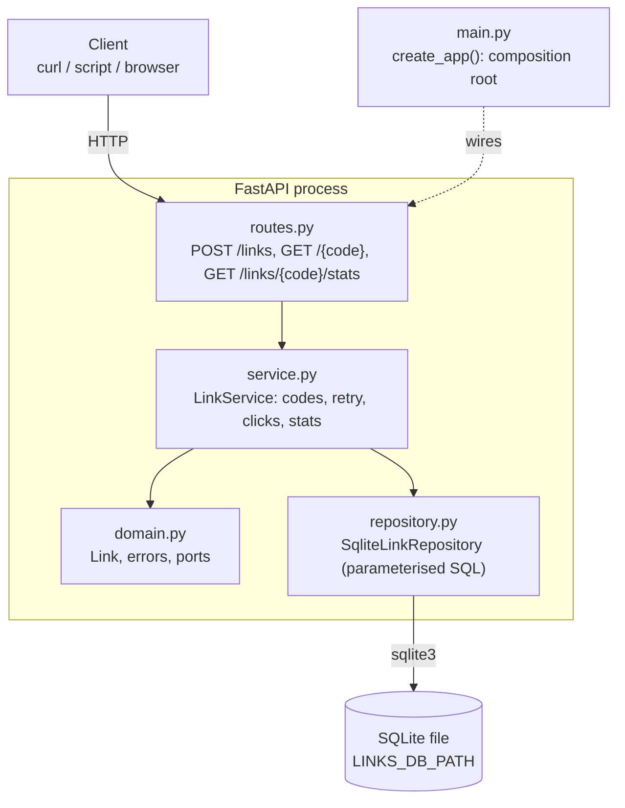

# bench-link-shortener

A small, self-hosted HTTP API (FastAPI + SQLite) that turns long URLs into 6-character short codes, redirects visitors with `307`, and counts clicks.
It is built as a quality benchmark: strict layering, `mypy --strict`, `ruff`, and a test suite with an 85% coverage floor.

[](https://github.com/AbrahamLinksus/bench-link-shortener/actions/workflows/ci.yml)

CI (`.github/workflows/ci.yml`) runs `scripts/check.sh` on every push and pull request.



## Features

- `POST /links` shortens a URL to a random 6-character code (`[A-Za-z0-9]`, case-sensitive).
- `GET /{code}` redirects to the original URL with `307` and adds one click.
- `GET /links/{code}/stats` returns the URL, the click count and the creation time.
- Data is kept in a local SQLite file and survives restarts.
- No external services, accounts or API keys.

## Tech stack

Python 3.12 · FastAPI (sync endpoints) · uvicorn · stdlib `sqlite3` · Pydantic (bundled with FastAPI) · uv · pytest + pytest-cov · ruff · mypy `--strict`.

## Architecture

- Layers: `routes` → `service` → `domain`; `repository` and `codes` implement the ports defined in `domain`; `main` is the only composition root.
- Each request opens its own SQLite connection (provider stored on `app.state`), so there is no shared connection and no lock.
- The layer rules are enforced by `tests/test_architecture.py`.
- Read more: [docs/ARCHITECTURE.md](docs/ARCHITECTURE.md) (as-built overview, request flows, design decisions, known limitations), [docs/LLD.md](docs/LLD.md) §0 (stack and layer map), [docs/WALKTHROUGH.md](docs/WALKTHROUGH.md) (guided code tour). The product scope is in [docs/SPEC.md](docs/SPEC.md).

## API

Examples assume the server runs on `http://localhost:8000`. With `PORT=9000 ./start.sh`, use port 9000 in the examples. The interactive OpenAPI docs are served at `/docs` (generated by FastAPI from the code).

### Shorten a URL: `POST /links`

```bash
curl -X POST localhost:8000/links \
  -H 'content-type: application/json' \
  -d '{"url": "https://example.com/page"}'
```

`201 Created`:

```json
{"code": "aZ3k9Q", "short_url": "http://localhost:8000/aZ3k9Q"}
```

`short_url` is built from the base URL of the incoming request, so with `PORT=9000` it starts with `http://localhost:9000/`.

Only absolute `http` or `https` URLs with a host, at most 2048 characters and without whitespace, are accepted. A missing, non-string or invalid `url`, or malformed JSON, returns `422` (FastAPI's standard validation body) and nothing is stored. The URL is stored exactly as submitted.

```bash
curl -i -X POST localhost:8000/links \
  -H 'content-type: application/json' \
  -d '{"url": "ftp://files.example.com/a.zip"}'
# the response is 422 (FastAPI validation error body); nothing is stored
```

### Follow a short link: `GET /{code}`

```bash
curl -i localhost:8000/aZ3k9Q
```

`307 Temporary Redirect` with `Location: https://example.com/page` and an empty body. Every request counts as a click.

An unknown code, or any path that is not a 6-character code, returns `404`:

```json
{"detail": "Link not found"}
```

### View link stats: `GET /links/{code}/stats`

```bash
curl localhost:8000/links/aZ3k9Q/stats
```

`200 OK`:

```json
{"url": "https://example.com/page", "clicks": 3, "created_at": "2026-11-09T10:00:00Z"}
```

`created_at` is UTC, second precision, with a `Z` suffix. Reading stats does not change the click count. An unknown code returns `404` with the body above.

## Requirements

- Python 3.12 or newer (`.python-version` is `3.12`).
- [uv](https://docs.astral.sh/uv/) for dependency and environment management. Install it by following the uv documentation; `start.sh` stops with a message if `uv` is not on `PATH`.
- Linux or macOS. No external services, accounts or API keys are needed.

## How to run

Fresh clone to a running API:

```bash
git clone https://github.com/AbrahamLinksus/bench-link-shortener.git
cd bench-link-shortener
cp .env.example .env    # optional: without it the defaults apply (see Configuration)
./start.sh              # runs uv sync, then serves on http://0.0.0.0:8000
```

`uv sync` (run by `start.sh` too, so it is optional) creates `.venv/` and installs the locked dependencies from `uv.lock`, including the dev group (pytest, ruff, mypy).

In a second terminal, smoke-test the running API:

```bash
curl -X POST localhost:8000/links -H 'content-type: application/json' -d '{"url": "https://example.com/page"}'
curl -i localhost:8000/<code>                 # use the code from the response above
curl localhost:8000/links/<code>/stats
```

Other ways to start it:

```bash
PORT=9000 ./start.sh    # serves on http://0.0.0.0:9000
```

`start.sh` checks that `uv` is installed, runs `uv sync`, then starts the API with `uv run uvicorn link_shortener.main:create_app --factory --app-dir src --host 0.0.0.0 --port ${PORT:-8000}`. Stop the server with Ctrl+C. Links and click counts are kept in the SQLite file (see Configuration) and are still there after a restart.

If the port is already in use, uvicorn prints its own error and exits non-zero.

Precedence for every setting: command line (`PORT=9000 ./start.sh`) → `.env` → default.

## Configuration

Settings are read from environment variables. To set them persistently for `start.sh`, copy `.env.example` to `.env` and edit it. Values set in the shell take precedence over `.env` (see How to run).

| Variable | Default | Meaning | Where the value comes from |
|---|---|---|---|
| `LINKS_DB_PATH` | `links.db` (relative to the working directory; `start.sh` runs from the project root) | SQLite file path. A blank value means the default. Parent directories are created on start. | Your choice; no account needed. |
| `PORT` | `8000` | Port used by `start.sh`. The app itself does not read it; with the direct uvicorn command, pass `--port` instead. | Your choice; no account needed. |

`.env` is git-ignored. `links.db` and other `*.db` files are git-ignored too.

## How to test

The full quality gate, the same one CI runs:

```bash
scripts/check.sh    # ruff check, ruff format --check, mypy --strict, pytest with coverage >= 85%
```

Individual commands:

```bash
uv run pytest                              # tests
uv run pytest --cov                        # tests + coverage report (package link_shortener)
uv run pytest --cov --cov-fail-under=85    # same, fails the run if coverage is below 85%
uv run ruff check .                        # lint
uv run ruff format --check .               # format check
uv run mypy --strict                       # type check
CHECK_NO_COVERAGE=1 scripts/check.sh       # the gate without coverage (plain pytest)
```

`--cov` only reports coverage; the 85% threshold is enforced by `--cov-fail-under=85`, which `scripts/check.sh` uses.

To run the fast checks (lint, format, types) before each commit:

```bash
git config core.hooksPath scripts/git-hooks
```

Tests use a temporary SQLite file per test and do not touch `links.db`. The `start.sh` precedence tests run a copy of the script with a stub `uv`; they start no server.

## How to extend

The step-by-step tour is in [docs/WALKTHROUGH.md](docs/WALKTHROUGH.md) §4; the layer rules are in [docs/ARCHITECTURE.md](docs/ARCHITECTURE.md) and [docs/LLD.md](docs/LLD.md) §0.3. The short version:

**Add an endpoint**

1. `src/link_shortener/schemas.py`: add the request and response models (Pydantic, HTTP only).
2. `src/link_shortener/service.py`: add a method to `LinkService` if the endpoint has logic. If it needs new SQL, add the method to the `LinkRepository` port in `domain.py`, implement it in `repository.py`, and add it to the fake in `tests/fakes.py`.
3. `src/link_shortener/routes.py`: add a function on `router`, declared **before** `GET /{code}`. Take the service as `service: LinkServiceDep`, and map `LinkNotFoundError` to a `404` with `raise HTTPException(...) from err`. Routes must not import `repository`, `db`, `codes` or `config`.
4. `tests/test_api_<name>.py`: add HTTP tests with the `client` fixture from `tests/conftest.py`.
5. Run `scripts/check.sh`.

**Add a configuration variable**

1. `src/link_shortener/config.py`: add a field to `Settings` and read it in `Settings.from_env` (strip the value; a blank value falls back to a named default).
2. `src/link_shortener/main.py`: pass the setting where it is used (in `create_app`).
3. `.env.example`: add the key with a one-line comment.
4. This README: add a row to the Configuration table.
5. `tests/test_config.py`: test the default and the override. `start.sh` already gives shell > `.env` > default to every variable.

**Other changes**

- A new module needs an entry in `CONTRACTS` in `tests/test_architecture.py`, or the test fails.
- A new storage backend or code strategy is a new class that implements the existing port (see WALKTHROUGH §4).
- Changing the table schema has no migration support yet; treat it as a change request (ARCHITECTURE §8).
- Adding a package is a decision for the project owner (CONVENTIONS §1).

## Project layout

```
src/link_shortener/
├── main.py         create_app(): composition root (wires everything)
├── routes.py       HTTP endpoints (no SQL, no business rules)
├── schemas.py      Pydantic request/response models and URL validation
├── service.py      LinkService: create, resolve and count clicks, stats
├── domain.py       Link entity, errors, code rules, ports (Protocols)
├── repository.py   SqliteLinkRepository: all SQL (parameterised)
├── db.py           SQLite connection and table creation
├── codes.py        RandomCodeGenerator (secrets-based)
└── config.py       Settings from environment variables
tests/              pytest suite, including layer-contract checks
scripts/check.sh    quality gate
scripts/git-hooks/  pre-commit hook (fast checks)
start.sh            one-command start (uv sync + uvicorn)
.env.example        settings template (copy to .env)
.github/workflows/  CI: scripts/check.sh on push and pull request
docs/               SPEC, HLD, LLD, CONVENTIONS, ARCHITECTURE, WALKTHROUGH
```

Dependencies point inward: routes → service → domain, with repository and codes implementing the domain ports. See [docs/LLD.md](docs/LLD.md) §0.3 for the full rules.

## Non-goals

No authentication or user accounts, no custom (vanity) codes, no link expiry, deletion or editing, no web UI, no deployment tooling, and no analytics beyond a total click count. There is no rate limiting and no URL de-duplication.
