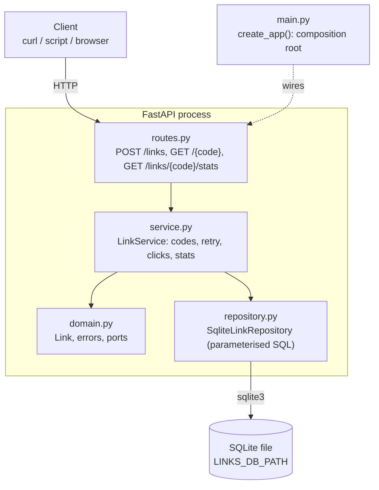

# bench-link-shortener

A small, self-hosted HTTP API (FastAPI + SQLite) that turns long URLs into 6-character short codes, redirects visitors with `307`, and counts clicks.



Layers (routes → service → repository) are described in [docs/LLD.md](docs/LLD.md) §0.3; the product scope is in [docs/SPEC.md](docs/SPEC.md).

## Features

- `POST /links` shortens a URL to a random 6-character code (`[A-Za-z0-9]`, case-sensitive).
- `GET /{code}` redirects to the original URL with `307` and adds one click.
- `GET /links/{code}/stats` returns the URL, the click count and the creation time.
- Data is kept in a local SQLite file and survives restarts.

## API

Examples assume the server runs on `http://localhost:8000`.

### Shorten a URL: `POST /links`

```bash
curl -X POST localhost:8000/links \
  -H 'content-type: application/json' \
  -d '{"url": "https://example.com/page"}'
```

`201 Created`:

```json
{"code": "aZ3k9Q", "short_url": "http://localhost:8000/aZ3k9Q"}
```

`short_url` is built from the base URL of the incoming request, so with `PORT=9000` it starts with `http://localhost:9000/`.

Only absolute `http` or `https` URLs with a host, at most 2048 characters and without whitespace, are accepted. A missing, non-string or invalid `url`, or malformed JSON, returns `422` (FastAPI's standard validation body) and nothing is stored. The URL is stored exactly as submitted.

### Follow a short link: `GET /{code}`

```bash
curl -i localhost:8000/aZ3k9Q
```

`307 Temporary Redirect` with `Location: https://example.com/page` and an empty body. Every request counts as a click.

An unknown code, or any path that is not a 6-character code, returns `404`:

```json
{"detail": "Link not found"}
```

### View link stats: `GET /links/{code}/stats`

```bash
curl localhost:8000/links/aZ3k9Q/stats
```

`200 OK`:

```json
{"url": "https://example.com/page", "clicks": 3, "created_at": "2026-11-09T10:00:00Z"}
```

`created_at` is UTC, second precision, with a `Z` suffix. Reading stats does not change the click count. An unknown code returns `404` with the body above.

## Requirements

- Python 3.12 or newer (`.python-version` is `3.12`).
- [uv](https://docs.astral.sh/uv/) for dependency and environment management.
- Linux or macOS. No external services, accounts or API keys are needed.

## Install

```bash
git clone <this repository> bench-link-shortener
cd bench-link-shortener
uv sync
```

`uv sync` creates `.venv/` and installs the locked dependencies from `uv.lock`.

## Run

Intended way (`start.sh` lands in milestone M2, task T-04; it is not in the repository yet):

```bash
./start.sh              # serves on http://0.0.0.0:8000
PORT=9000 ./start.sh    # serves on port 9000
```

`start.sh` runs `uv sync`, then starts uvicorn on `0.0.0.0:${PORT:-8000}`. It sources `.env` if the file exists.

Until `start.sh` exists, run the app directly from the project root:

```bash
uv run uvicorn link_shortener.main:create_app --factory --app-dir src --host 0.0.0.0 --port 8000
```

`--app-dir src` is required because the package lives in `src/`. Change `--port` for another port. Stop the server with Ctrl+C.

## Configuration

Settings are read from environment variables. Copy `.env.example` to `.env` to set them for `start.sh`.

| Variable | Default | Meaning |
|---|---|---|
| `LINKS_DB_PATH` | `links.db` (relative to the working directory, i.e. the project root when started as above) | SQLite file path. A blank value means the default. Parent directories are created on start. |
| `PORT` | `8000` | Port used by `start.sh`. The app itself does not read it; with the direct command, pass `--port`. |

`links.db` and other `*.db` files are git-ignored.

## Test and quality checks

```bash
uv run pytest                                  # tests
uv run pytest --cov=link_shortener             # tests with coverage
uv run ruff check .                            # lint
uv run ruff format --check .                   # format check
uv run mypy --strict                           # type check
scripts/check.sh                               # the full gate: lint, format, types, tests with coverage >= 85%
```

To run the fast checks (lint, format, types) before each commit:

```bash
git config core.hooksPath scripts/git-hooks
```

Tests use a temporary SQLite file per test and do not touch `links.db`.

## Project layout

```
src/link_shortener/
├── main.py         create_app(): composition root (wires everything)
├── routes.py       HTTP endpoints (no SQL, no business rules)
├── schemas.py      Pydantic request/response models and URL validation
├── service.py      LinkService: create, resolve and count clicks, stats
├── domain.py       Link entity, errors, code rules, ports (Protocols)
├── repository.py   SqliteLinkRepository: all SQL (parameterised)
├── db.py           SQLite connection and table creation
├── codes.py        RandomCodeGenerator (secrets-based)
└── config.py       Settings from environment variables
tests/              pytest suite, including layer-contract checks
scripts/check.sh    quality gate
docs/               SPEC, HLD, LLD, CONVENTIONS
```

Dependencies point inward: routes → service → domain, with repository and codes implementing the domain ports. See [docs/LLD.md](docs/LLD.md) §0.3 for the full rules.

## Non-goals

No authentication or user accounts, no custom (vanity) codes, no link expiry, deletion or editing, no web UI, no deployment tooling, and no analytics beyond a total click count. There is no rate limiting and no URL de-duplication.
