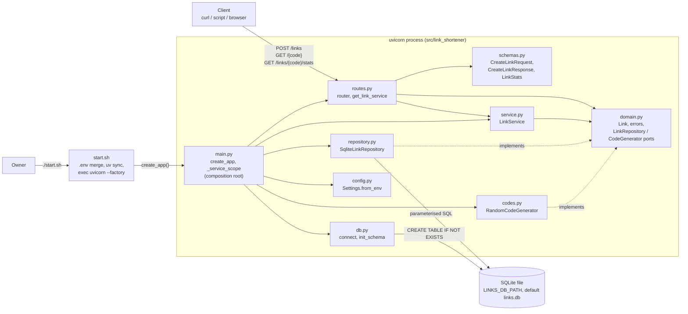
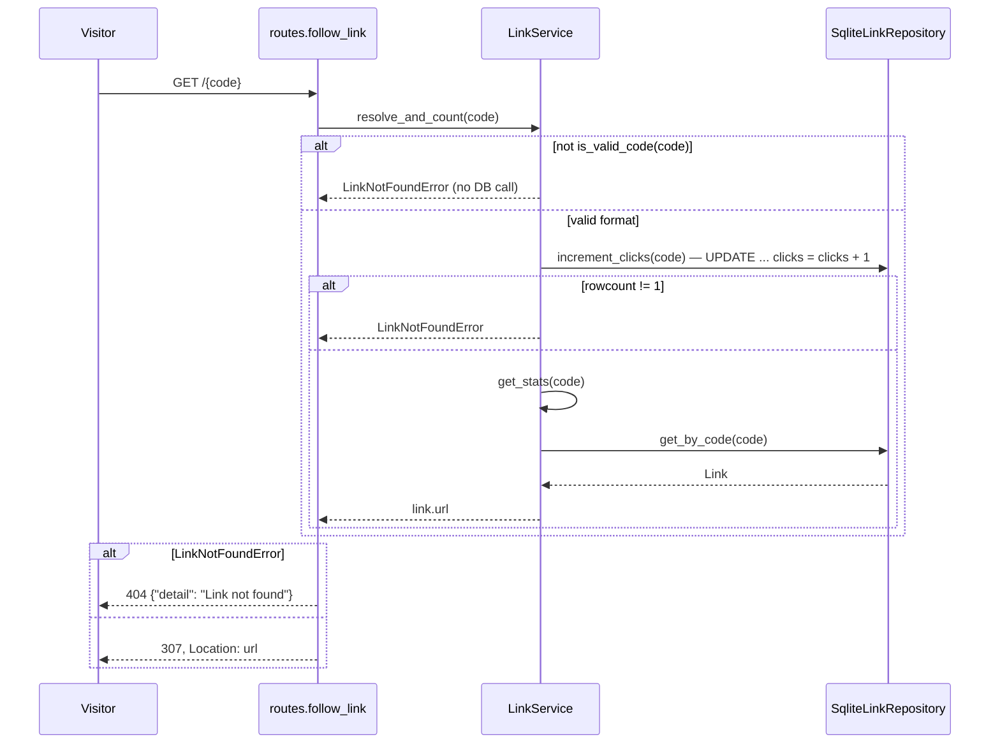
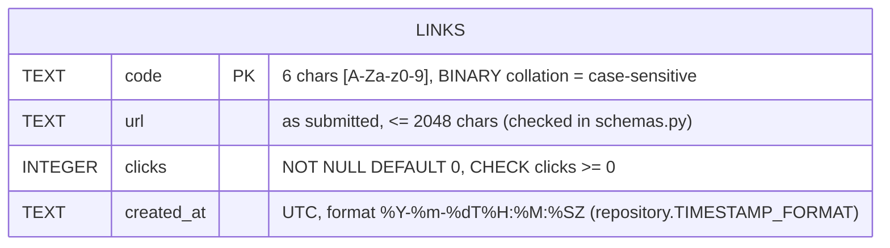

# Architecture (as built) — bench-link-shortener

> Final, as-built description written at handover by the architect, from the code, not
> from the original plan. Deviations from the plan are listed in §7.
> Code state: main ad2e64a (T-01 … T-04b) plus the handover CI workflow. Section references
> written `LLD §n` point at `docs/LLD.md`; `D-nn` at `DECISIONS.md`.

## 1. What it is
A small, self-hosted HTTP API (FastAPI + stdlib `sqlite3`) that turns long URLs into random
6-character codes, redirects visitors with `307` and counts clicks, keeping data in one SQLite
file across restarts. It runs locally with `./start.sh` and is built as a quality benchmark:
strict layering, `mypy --strict`, `ruff`, and a test suite with a coverage floor of 85%.

## 2. System diagram


## 3. Components
| Component | Path | Responsibility | Depends on |
|---|---|---|---|
| Config | `src/link_shortener/config.py` | `Settings` (frozen dataclass, one field `db_path`); `Settings.from_env` reads `LINKS_DB_PATH`, blank → `DEFAULT_DB_PATH` (`links.db`) | stdlib only |
| Domain | `src/link_shortener/domain.py` | `Link` entity, `is_valid_code`, `CODE_ALPHABET` / `CODE_LENGTH`, errors `LinkNotFoundError` / `DuplicateCodeError` / `CodeGenerationError`, ports `LinkRepository` / `CodeGenerator` (Protocols), `Clock` alias, `utc_now` | stdlib only |
| Code generator | `src/link_shortener/codes.py` | `RandomCodeGenerator.generate`: 6 chars from `CODE_ALPHABET` via `secrets.choice` | domain |
| Database | `src/link_shortener/db.py` | `connect` (autocommit, `check_same_thread=False`, `timeout=BUSY_TIMEOUT_SECONDS`), `init_schema` (`SCHEMA_SQL`, creates parent dir) | stdlib `sqlite3` |
| Repository | `src/link_shortener/repository.py` | `SqliteLinkRepository.add` / `get_by_code` / `increment_clicks`; all link SQL; `IntegrityError` → `DuplicateCodeError`; row ⇄ `Link` via `_row_to_link` | domain, `sqlite3` connection passed in |
| Service | `src/link_shortener/service.py` | `LinkService.create_link` (collision retry, `DEFAULT_MAX_ATTEMPTS = 10`), `resolve_and_count`, `get_stats` | domain only (ports) |
| Schemas | `src/link_shortener/schemas.py` | Pydantic HTTP models; URL rules in `CreateLinkRequest._check_url` → `_has_forbidden_char`, `_validate_http_url`; `LinkStats` serialises `created_at` as `YYYY-MM-DDTHH:MM:SSZ` | pydantic, stdlib `urllib.parse` |
| Routes | `src/link_shortener/routes.py` | `router` with `create_link` (POST `/links`), `get_stats` (GET `/links/{code}/stats`), `follow_link` (GET `/{code}`); `get_link_service` dependency; maps `LinkNotFoundError` → 404 `NOT_FOUND_DETAIL` | domain, service, schemas, FastAPI |
| App factory | `src/link_shortener/main.py` | `create_app` (composition root) and `_service_scope` (one connection + `LinkService` per request) | everything above |
| Start script | `start.sh` | checks `uv`, merges `.env` with "shell wins" precedence, `uv sync`, `exec uv run uvicorn link_shortener.main:create_app --factory --app-dir src --host 0.0.0.0 --port "${PORT:-8000}"` | `main.create_app` |
| Quality gate | `scripts/check.sh` | ruff check, ruff format check, `mypy --strict`, pytest with `--cov-fail-under=85` (or no coverage when `CHECK_NO_COVERAGE=1`) | dev group in `pyproject.toml` |
| Pre-commit hook | `scripts/git-hooks/pre-commit` | ruff check, ruff format check, `mypy --strict` (enable with `git config core.hooksPath scripts/git-hooks`) | dev group |
| CI | `.github/workflows/ci.yml` | on push / PR: setup-uv, `uv sync --locked`, `scripts/check.sh` | `uv.lock`, `scripts/check.sh` |
| Tests | `tests/` | 14 test modules + `conftest.py` fixtures + `fakes.py` doubles (see §8) | public interfaces of the modules above |

## 4. Key flows (as implemented)

### Startup (`./start.sh`)
```mermaid
sequenceDiagram
    participant O as Owner shell
    participant SH as start.sh
    participant UV as uv / uvicorn
    participant M as main.create_app
    participant C as config.Settings
    participant DB as db.init_schema
    O->>SH: PORT=9000 ./start.sh
    SH->>SH: command -v uv (missing → message, exit 1)
    alt .env exists
        SH->>SH: snapshot exported vars (compgen -e)
        SH->>SH: set -a; . ./.env; set +a
        SH->>SH: restore any snapshot value .env changed (shell wins)
    end
    SH->>UV: uv sync
    SH->>UV: exec uv run uvicorn link_shortener.main:create_app --factory --port ${PORT:-8000}
    UV->>M: create_app()
    M->>C: Settings.from_env()
    M->>DB: init_schema(settings.db_path)
    M->>M: app.state.link_service_provider = partial(_service_scope, db_path)
    M->>M: app.include_router(router)
    M-->>UV: FastAPI app
```
Files involved, in order: `start.sh` (lines 4–28) → `src/link_shortener/main.py::create_app` →
`src/link_shortener/config.py::Settings.from_env` → `src/link_shortener/db.py::init_schema` →
`src/link_shortener/routes.py` (`SERVICE_PROVIDER_KEY`, `router`).

### Shorten a URL (`POST /links`)
```mermaid
sequenceDiagram
    participant C as Client
    participant R as routes.create_link
    participant SC as schemas.CreateLinkRequest
    participant P as routes.get_link_service / main._service_scope
    participant S as LinkService
    participant G as RandomCodeGenerator
    participant RP as SqliteLinkRepository
    C->>R: POST /links {"url": ...}
    R->>SC: validate body (strict str, 1..2048, _check_url)
    alt invalid
        SC-->>C: 422 (FastAPI validation body)
    end
    R->>P: resolve LinkServiceDep
    P->>P: db.connect(db_path); LinkService(...)
    R->>S: create_link(url)
    S->>S: now = clock() to UTC, microsecond 0 (once)
    loop up to max_attempts (10)
        S->>G: generate()
        S->>RP: add(Link(code, url, 0, now))
        alt IntegrityError → DuplicateCodeError
            S->>S: log code_collision, next attempt
        else stored
            S-->>R: Link
        end
    end
    R-->>C: 201 {"code", "short_url": request.base_url + code}
    P->>P: connection.close()
```
Files involved, in order: `src/link_shortener/routes.py::create_link` →
`src/link_shortener/schemas.py::CreateLinkRequest._check_url` →
`src/link_shortener/routes.py::get_link_service` → `src/link_shortener/main.py::_service_scope` →
`src/link_shortener/db.py::connect` → `src/link_shortener/service.py::LinkService.create_link` →
`src/link_shortener/codes.py::RandomCodeGenerator.generate` →
`src/link_shortener/repository.py::SqliteLinkRepository.add` → back to `routes.create_link`.

### Follow a short link (`GET /{code}`)

Files involved, in order: `src/link_shortener/routes.py::follow_link` →
`src/link_shortener/service.py::LinkService.resolve_and_count` →
`src/link_shortener/domain.py::is_valid_code` →
`src/link_shortener/repository.py::SqliteLinkRepository.increment_clicks` →
`src/link_shortener/service.py::LinkService.get_stats` →
`src/link_shortener/repository.py::SqliteLinkRepository.get_by_code` → `_row_to_link`.

### View stats (`GET /links/{code}/stats`)
Same shape without the increment: `routes.get_stats` → `LinkService.get_stats` →
`SqliteLinkRepository.get_by_code` → `schemas.LinkStats` (serialises `created_at`). Unknown or
invalid code → `LinkNotFoundError` → 404.

## 5. Data model
One table, created by `db.SCHEMA_SQL` in `src/link_shortener/db.py`; no migrations.

In memory the row is `domain.Link` (frozen dataclass, `created_at` timezone-aware UTC).

## 6. Design decisions
| Decision | Chosen | Why | Alternative rejected | Ref |
|---|---|---|---|---|
| Stack | Python 3.12, FastAPI, stdlib `sqlite3`, uv, uvicorn (no extras) | Fixed by owner | `uvicorn[standard]` (extra packages) | SPEC §10, LLD §0.1 |
| Package pinning | `>=` floors in `pyproject.toml`, exact versions in `uv.lock` | Owner chose latest at lock time | exact `==` pins | D-05, LLD §0.4 |
| Endpoints | sync `def` | Blocking `sqlite3` runs in the threadpool, never blocks the event loop | `async def` | LLD §0.1 |
| Connections | one connection per request (`main._service_scope`), autocommit, `check_same_thread=False`, 5 s busy timeout | Thread-safe without a global lock | one shared connection + `threading.Lock` | LLD §4.5, HLD risks |
| Click counting | single `UPDATE links SET clicks = clicks + 1` | Atomic; no lost clicks (concurrency test 8 × 25 = 200) | read-modify-write | LLD §5.5 |
| Ports | `LinkRepository`, `CodeGenerator` Protocols + `Clock` callable in `domain.py` | The three variation points; tests use fakes instead of patches | interfaces everywhere / `unittest.mock.patch` | CONVENTIONS §3 |
| Composition root | `main.create_app` only; service provider stored on `app.state` under `routes.SERVICE_PROVIDER_KEY` | Routes never import `repository` / `db` / `config` | FastAPI `dependency_overrides` from `main` | LLD §8, §9 |
| No module-level `app` | uvicorn `--factory` | Importing `main` never creates `links.db` (tested) | `app = create_app()` at import | LLD §9 |
| `{code}` path param | plain `str`; `LinkService` checks `is_valid_code` | SPEC wants `404` (not `422`) for any non-code path | `Path(pattern=...)` (HLD mitigation) → 422 | LLD §8.5 |
| URL validation | Pydantic strict `str` + `urllib.parse.urlsplit` in `schemas.py` | URL stored exactly as submitted | `pydantic.AnyHttpUrl` (normalises) | LLD §0.1, §7.5 |
| Config | frozen dataclass `Settings.from_env` | `pydantic-settings` not allowed | `pydantic-settings` | LLD §1 |
| Layer rules | AST test `tests/test_architecture.py` (`CONTRACTS`) | No new package | import-linter (not allowed) | LLD §0.3, §11.3 |
| Complexity limits | ruff `C90` / `PL` rules | Already in ruff | radon (not allowed) | CONVENTIONS §6 |
| `.env` precedence | shell (exported) → `.env` → default, generic for every variable | `.env` overrode `PORT=9000 ./start.sh` (SPEC US-07) | keep ".env wins" and document | D-13, D-14, LLD §10.1 |
| Pre-commit | plain bash hook in `scripts/git-hooks/` via `core.hooksPath` | `pre-commit` package not allowed | `pre-commit` framework | LLD §10.6 |

## 7. Deviations from the original design
| Planned (LLD v1) | Built | Why | Ref |
|---|---|---|---|
| Exact `==` package pins | `>=` floors + `uv.lock` | Owner decision | D-05 |
| No ruff exclude | `extend-exclude = ["docs"]` in `pyproject.toml` | ruff 0.17 formats Markdown and failed `ruff format --check` on `docs/` | LLD §10.3 |
| No pre-commit hook | `scripts/git-hooks/pre-commit` | Keep the fast gate local without a new package | LLD §10.6 |
| No CI (deployment is a non-goal) | `.github/workflows/ci.yml` runs `scripts/check.sh` on push / PR | Handover step; check only, no deployment | LLD §10.7 |
| `resolve_and_count` reads the row itself | it calls `get_stats(code).url` | Removes duplicated not-found logic | LLD §6.1, T-02 |
| URL rules in one validator | split into `_has_forbidden_char` and `_validate_http_url` | Small functions | LLD §7.1, T-02 |
| Row mapping coerces types | `_row_to_link` raises `TypeError` on unexpected column types | `mypy --strict` without silent coercion | LLD §5.5, T-01 |
| Magic busy timeout | `BUSY_TIMEOUT_SECONDS: Final = 5.0` | No magic constants | LLD §4.1, T-01 |
| HLD name `LinkNotFound` | `LinkNotFoundError` | ruff `N818` | LLD §2.1 |
| Test files per endpoint only | extra `tests/test_api_edge.py`, plus many edge tests per file | Tester coverage | LLD §11.1, T-03 |
| `start.sh` (T-04): `.env` sourced last, so `.env` won | snapshot / source / restore: exported shell values win | Contrary to SPEC US-07 / F-4 | CR-1, D-13, T-04b |
| — | `tests/test_start_script.py` (stub `uv`, no server) | Regression test for CR-1 | LLD §11.5, T-04b |

## 8. Quality gates
**What `scripts/check.sh` enforces** (run locally, by CI, and by the tester on every task):
1. `uv run ruff check .` — rules `E,F,W,I,N,UP,B,SIM,C90,PL,RUF`; complexity ≤ 10 (`C901`),
   ≤ 5 args (`PLR0913`); `tests/**` may use literal numbers (`PLR2004` ignored).
2. `uv run ruff format --check .`
3. `uv run mypy --strict` — `files = ["src", "tests"]`, `pydantic.mypy` plugin.
4. `uv run pytest -q --cov=link_shortener --cov-report=term-missing --cov-fail-under=85`
   (branch coverage on; `CHECK_NO_COVERAGE=1` runs plain `pytest -q`). The layer contracts run
   here as `tests/test_architecture.py`.

**Where it runs**
- Locally: `scripts/check.sh`; fast half before commits via `scripts/git-hooks/pre-commit`
  after `git config core.hooksPath scripts/git-hooks`.
- CI: `.github/workflows/ci.yml` (workflow `CI`, job `check`, `ubuntu-latest`, 15 min timeout,
  on every `push` and `pull_request`, read-only `contents` permission, superseded runs on the
  same ref are cancelled). Steps: `actions/checkout@v7.0.1` → `astral-sh/setup-uv@v10.3.3`
  (Python from `.python-version`, cache keyed on `uv.lock`) → `uv sync --locked` →
  `scripts/check.sh`.

**Current result** (workflow `.github/workflows/ci.yml`; first green run: GitHub Actions run
42629337163 on branch `wip/handover`, 2026-11-09): 115 tests passed, coverage 99.18% (floor 85%).

### Known limitations and tech debt
Owner-accepted review minors from T-04b (D-15):
- **`start.sh` without `compgen`.** On a bash built with `--disable-progcomp`, `$(compgen -e)`
  fails inside the `for` word list, which does not stop the script under `set -e`; the snapshot
  is empty, so `.env` silently wins again (the old T-04 behaviour). Stock bash on Linux and
  macOS includes `compgen`. (`start.sh` line 12; LLD §10.1.)
- **`SHELLOPTS` / `BASHOPTS`.** These are readonly but rewritten by bash itself. If the caller
  exported one of them and `.env` runs `set -o …` / `shopt …`, the restore `export`
  (`start.sh` line 21) hits a readonly variable and the script stops under `set -e`. Out of
  scope because `.env` is documented as plain `KEY=value` lines. (LLD §10.1 design note,
  corrected at handover.)
- **README wording "set" vs "exported".** `README.md` (Configuration) says values "set in the
  shell" take precedence; precisely, only **exported** variables do (`PORT=9000 ./start.sh` or
  `export PORT=9000`). A plain `PORT=9000` line followed by `./start.sh` is invisible to the
  script, so `.env` applies.
- **No test for set-but-empty `PORT`.** `PORT= ./start.sh` falls back to 8000 even when `.env`
  sets `PORT` (documented in LLD §10.1), but `tests/test_start_script.py` does not cover it.

Other known issues:
- Starlette warns that the httpx-based `TestClient` transport is deprecated (warning only;
  replacing it would be a package change, Tier 1). LLD §11.4.
- Some test names in `tests/test_service.py`, `tests/test_schemas.py` and
  `tests/test_persistence.py` are short (e.g. `test_collision_retries`) instead of
  `test_<unit>_<condition>_<expected>` (CONVENTIONS §5). Cosmetic. LLD §11.4.
- No schema migrations: `SCHEMA_SQL` uses `CREATE TABLE IF NOT EXISTS`; any column change
  needs a change request and a migration plan. LLD §4.3.
- `CodeGenerationError` (10 collisions in a row) is not mapped and surfaces as a 500;
  practically unreachable at 62⁶ codes. LLD §6.5.
- `short_url` is built from the request's base URL, so behind a reverse proxy it reflects
  whatever host / scheme the app sees. LLD §8.5, HLD risks.
