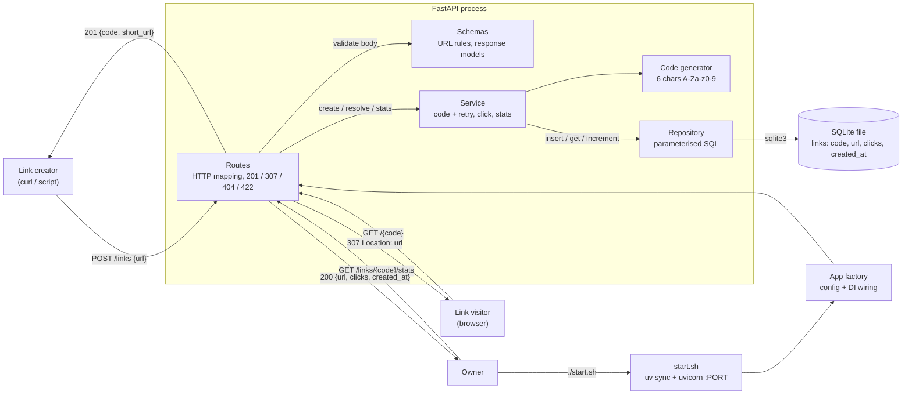

# High-level design — bench-link-shortener

> Derived from the approved `docs/SPEC.md` only. Story IDs (US-xx) and flow IDs (F-x) refer to SPEC.

## Problem & goal
A developer wants a minimal, self-hosted HTTP API that shortens long URLs into 6-character
codes, redirects visitors via `307`, and counts clicks, with data kept in SQLite across restarts.
It doubles as a quality benchmark. It needs layered code (routes → service → repository), tests for every
endpoint including error cases, coverage ≥ 85%, and clean `ruff` and `mypy --strict`. The owner
starts it with one command (`./start.sh`).

## Users & main use cases
| User | Main use case | Flow |
|---|---|---|
| Link creator (script / `curl`) | `POST /links` → `201` `{code, short_url}`; invalid URL → `422` | F-1 |
| Link visitor (browser / HTTP client) | `GET /{code}` → `307` to the original URL, +1 click; unknown → `404` | F-2 |
| Owner / operator | `GET /links/{code}/stats`; run with `./start.sh`; restart without data loss; run tests/lint/types | F-3, F-4 |

## Scope
- In:
  - Three endpoints: `POST /links`, `GET /{code}`, `GET /links/{code}/stats`.
  - URL validation: absolute, `http`/`https`, has a host, ≤ 2048 chars. Anything else → `422`.
  - Random unique 6-char `[A-Za-z0-9]` codes, case-sensitive, with retry on collision.
  - Atomic click counting. Stats show `url`, `clicks`, `created_at` (UTC ISO-8601, `Z`).
  - SQLite persistence via stdlib `sqlite3`. The DB path is configurable by env var, with a project-local, git-ignored default.
  - `start.sh` (`uv sync` + uvicorn on `0.0.0.0:${PORT:-8000}`) and `README.md`.
  - Test suite (pytest + httpx TestClient, temp DB), `ruff`, `mypy --strict`.
- Out (copied from SPEC §11):
  - Authentication / user accounts / API keys.
  - Custom (vanity) codes chosen by the client.
  - Link expiry, deletion or editing.
  - A web UI of any kind.
  - Deployment (Docker, cloud, CI/CD hosting).
  - Analytics beyond a total click count (no per-click referrer, IP, geo or time series).
  - Rate limiting and URL de-duplication.

## Success metrics
| Metric | Target | How it is checked |
|---|---|---|
| Endpoint behaviour matches SPEC §5 examples | 100% of rows | pytest endpoint tests (one or more per row) |
| Test coverage | ≥ 85% | `uv run pytest --cov` |
| Lint / types | 0 errors | `uv run ruff check .`, `uv run mypy --strict` |
| Persistence across restart | Same `url`, `clicks: 2` after restart (US-06) | Test with a file-backed DB reopened by a fresh app instance, plus manual `./start.sh` check |
| No lost clicks under concurrency | N concurrent `GET /{code}` → `clicks == N` | Single `UPDATE … SET clicks = clicks + 1` statement; concurrency test |
| One-command start | `./start.sh` serves on 8000 / `$PORT` | Manual check per SPEC §12 |

## Modules
Layers flow only downward: routes → service → repository → SQLite. The routes layer never touches SQL.
The repository never knows about HTTP.

| Module | Responsibility | Talks to |
|---|---|---|
| **config** | Reads settings from env: DB file path (project-local default) and nothing else needed at runtime. The port is handled by `start.sh`/uvicorn. | app factory |
| **app factory** | Builds the FastAPI app: loads config, opens/initialises the DB (creates the table on first start), wires repository → service → routes through dependency injection so tests can swap in a temp DB. | config, db, routes, service, repository |
| **schemas** | Request/response models: `CreateLinkRequest` (URL validation rules), `CreateLinkResponse` (`code`, `short_url`), `LinkStats` (`url`, `clicks`, `created_at` formatted `YYYY-MM-DDTHH:MM:SSZ`). | routes |
| **routes** (HTTP layer) | Maps HTTP to service calls. `POST /links` → `201`. `GET /links/{code}/stats` → `200`. `GET /{code}` → `307` + `Location`. It builds `short_url` from the request base URL and maps "not found" to `404 {"detail": "Link not found"}`. The stats route is registered before the catch-all `/{code}`. | schemas, service |
| **service** (domain logic) | Creates links: generates the code, retries on collision, stamps `created_at` (UTC, second precision). Resolves a code and records a click. Returns stats without counting. Raises a domain `LinkNotFound` error. Holds no SQL and no HTTP knowledge. | code generator, repository |
| **code generator** | Produces a random 6-char string from `[A-Za-z0-9]` using a cryptographically random source. It is injectable so tests can force collisions. | service |
| **repository** (SQLite) | Owns all SQL, using parameterised queries only. Operations: `insert` (fails cleanly on duplicate code), `get by code`, `increment clicks atomically` (reports whether a row matched). Uses the stdlib `sqlite3` only. | db / SQLite file |
| **db** (schema + connection) | Opens the SQLite connection for the configured path and creates the `links` table if it is missing. The table holds `code` (primary key, case-sensitive), `url`, `clicks` (int ≥ 0, default 0) and `created_at`. | SQLite file |
| **start.sh** | Checks that `uv` exists (if not, prints a clear message pointing to README and exits non-zero), runs `uv sync`, then starts uvicorn on `0.0.0.0:${PORT:-8000}`. | app factory (via uvicorn) |
| **README.md** | Install, run (`./start.sh`, `$PORT`), test (`pytest --cov`), lint (`ruff`), type-check (`mypy --strict`). | — |
| **tests** | Endpoint tests for every success and error case in SPEC §5, plus service unit tests (collision retry), repository tests (atomic increment, persistence across reopen). Each test gets a temp DB. | app factory, service, repository |

### User story → module mapping
| Story | Primary module(s) | Supporting |
|---|---|---|
| US-01 Shorten URL (`201`, code, short_url) | routes, service, code generator, repository | schemas, db |
| US-02 Reject invalid URL (`422`, nothing stored) | schemas | routes |
| US-03 Redirect `307` + exactly +1 click | routes, service, repository (atomic increment) | db |
| US-04 Unknown code → `404`, no click | service (`LinkNotFound`), routes (404 mapping), repository (increment reports no match) | — |
| US-05 Stats `200` / `404` | routes, service, repository | schemas (`created_at` format) |
| US-06 Data survives restart | db (file-backed SQLite), config (DB path) | repository, app factory |
| US-07 `./start.sh` on 8000 / `$PORT` | start.sh | app factory, config |
| US-08 README install/run/test | README.md | — |

## Data flow

Standalone copy: `.results/hld/hld.mmd`.

## Milestones
| # | Milestone | Outcome (visible) |
|---|---|---|
| M1 | Project skeleton & persistence | `uv sync` works. Running `ruff` and `mypy --strict` on the empty package is clean. The repository and db layers create the `links` table and pass tests for insert / get / atomic increment, and the data is still there after reopening the file. |
| M2 | Shorten & stats | `POST /links` returns `201` with a 6-char code and `short_url` (`422` on invalid input). `GET /links/{code}/stats` returns `200`/`404`. Endpoint tests are green. |
| M3 | Redirect & click counting | `GET /{code}` returns `307` with the right `Location` and stats show clicks rising. Unknown code → `404` with no click. Concurrency test shows no lost clicks. |
| M4 | Run, docs & quality gate | `./start.sh` serves on 8000 and on `$PORT`. A restart keeps links and counts. README is complete. `pytest --cov` ≥ 85%, `ruff` and `mypy --strict` clean. All SPEC §12 boxes are ticked. |

## Risks & assumptions
**Risks**
| Risk | Impact | Mitigation |
|---|---|---|
| Route clash: `GET /{code}` catch-all could shadow `/links/...` or `/docs` | Wrong handler / broken stats | Register `/links/...` routes first. Constrain `{code}` to exactly 6 `[A-Za-z0-9]` characters, so anything else returns `404 Link not found` (SPEC F-2). Test it. |
| Lost clicks under concurrent requests | Wrong counts | One atomic `UPDATE … clicks = clicks + 1 WHERE code = ?` and no read-modify-write. Covered by a test. |
| SQLite connection used across threads (FastAPI runs sync endpoints in a threadpool) | `ProgrammingError` / flaky tests | Use a connection per request, or one with `check_same_thread=False` plus a lock. The LLD picks one (Tier 2). |
| Code collision | Duplicate key error | Primary key uniqueness, with retry in the service. A bounded retry count raises a clear error if exhausted (practically unreachable at 62⁶). |
| `mypy --strict` friction with `sqlite3` rows / FastAPI dependencies | Gate failures late | Typed row mapping in the repository from M1. Run the gate in every milestone. |
| `short_url` wrong behind a proxy or with a different port | Wrong link returned | Built from the request base URL (SPEC F-1). Tested with the test client and checked manually with `PORT=9000`. |
| Open-redirect / script URLs | Security | Only `http`/`https` with a host are accepted (SPEC §9). |

**Assumptions** (from SPEC; *(assumed)* items there apply unchanged)
- Single process, single machine, low volume (≈10k links). No caching or scaling layer needed.
- `created_at` is stored as UTC and returned at second precision with a `Z` suffix.
- No URL normalisation or de-duplication. Every `GET /{code}` counts, including bots and repeat visits.
- The DB path comes from an env var with a project-local, git-ignored default. Tests use a temp DB per test.
- No new packages beyond the fixed stack (FastAPI, uvicorn, httpx, pytest, pytest-cov, ruff, mypy). URL validation uses Pydantic (bundled with FastAPI) and/or stdlib `urllib.parse`.
