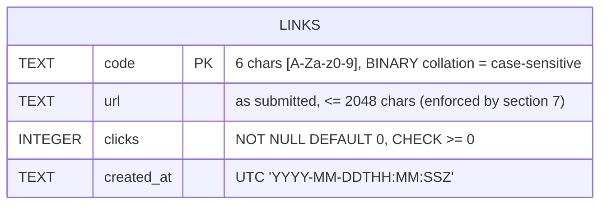
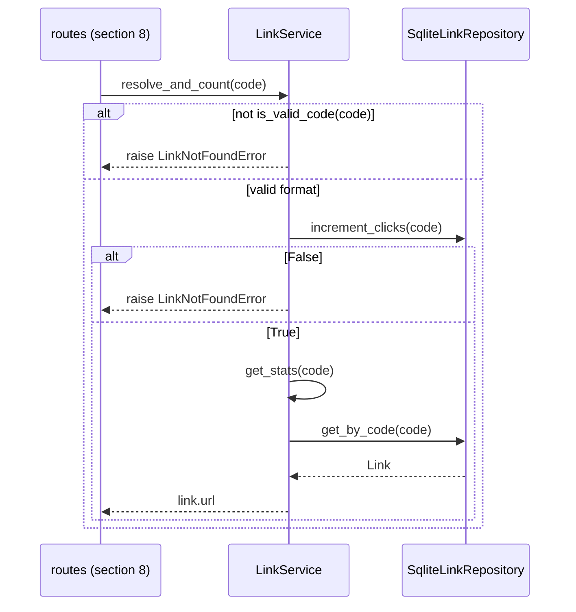
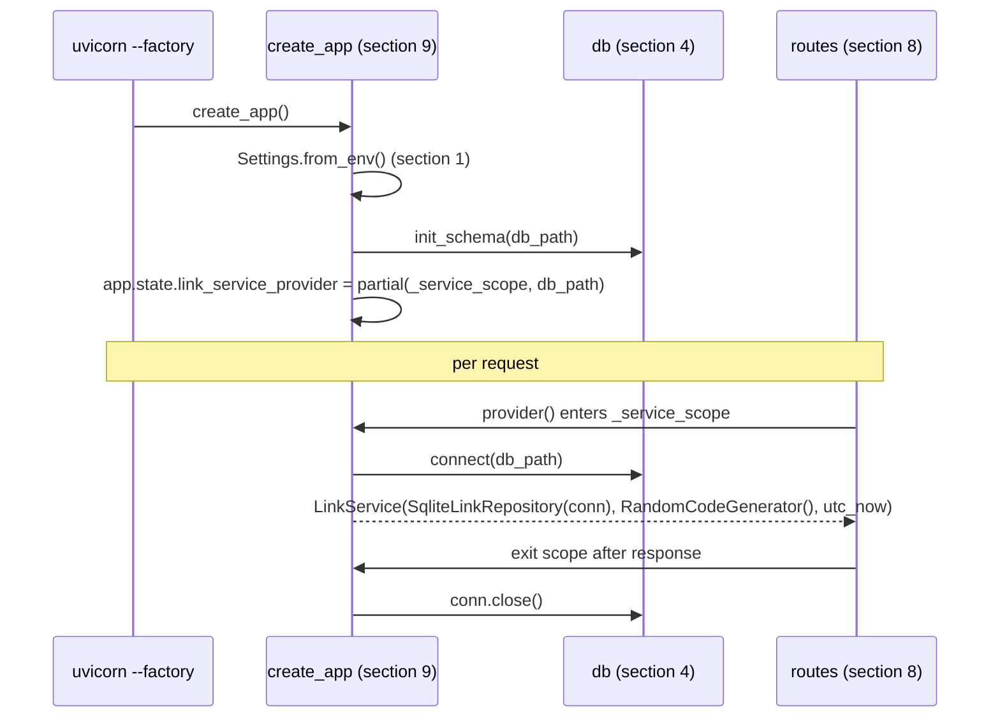

# Low-level design — bench-link-shortener

> Every section is numbered and self-contained, so a task can be briefed with only the
> sections it needs (e.g. `LLD §2, §5`). Each module section holds its responsibility,
> interfaces, contracts and schema in one place; it refers to other modules only by number.
> **Numbers are stable**: at milestone as-built syncs and change requests, update sections in
> place and give new sections new numbers. Never renumber; mark removed sections `(removed)`.
>
> Source: approved `docs/SPEC.md` and `docs/HLD.md`. Stack fixed by the owner (`docs/owner-spec.md`).
> Story IDs (US-xx) and flow IDs (F-x) refer to SPEC.
>
> **As-built status:** synced to the code at the end of M1 (T-01, T-02, T-03). §10.1 / §10.4
> (`start.sh`, `.env.example`, `.gitignore`) and §10.5 (README) are still design-only (M2).

## §0 Overview

### §0.1 Stack
| Layer | Choice | Why | Rejected alternative |
|---|---|---|---|
| Language | Python 3.12+ (`requires-python = ">=3.12"`, `.python-version` = `3.12`) | Fixed by owner | — (fixed) |
| Project / env | `uv` (virtual project, **no build backend**; `src/` put on the path via tool config, §10.3) | Fixed by owner; no build backend means no extra build package | `uv_build` / `hatchling` backend — an extra build-time package outside the owner's list |
| Web framework | FastAPI (sync `def` endpoints) | Fixed by owner. Sync endpoints run in FastAPI's threadpool, so blocking `sqlite3` calls never block the event loop | `async def` endpoints — blocking sqlite3 calls would stall the loop |
| Validation / models | Pydantic v2 (bundled with FastAPI) + stdlib `urllib.parse` | No extra package; `urlsplit` keeps the URL exactly as submitted (SPEC F-1) | `pydantic.AnyHttpUrl` — normalises the URL (adds `/`, lowercases host), breaking "stored exactly as submitted" |
| Persistence | stdlib `sqlite3`, one connection per request, autocommit | Fixed by owner. Per-request connections are thread-safe without a global lock (HLD risk "SQLite across threads", Tier 2 resolved here) | One shared connection + `threading.Lock` — serialises all requests and needs lock discipline everywhere |
| Config | frozen `dataclass` read from `os.environ` | Owner forbids `pydantic-settings`; one setting only | `pydantic-settings` — not allowed |
| ASGI server | `uvicorn` (plain, no `[standard]` extra) via `--factory` | Allowed extra; `[standard]` would pull uvloop/httptools/watchfiles | `uvicorn[standard]` — extra packages |
| Tests | `pytest` + `pytest-cov` + FastAPI `TestClient` (needs `httpx`) | Fixed / allowed | — (known issue: current Starlette warns that the httpx-based `TestClient` transport is deprecated; warning only, no package change, §11.4) |
| Lint / format / types | `ruff check`, `ruff format --check`, `mypy --strict` (+ `pydantic.mypy` plugin, shipped inside pydantic) | Fixed by owner | — |
| Layer rules | AST-based test `tests/test_architecture.py` (stdlib `ast`) | Enforces §0.3 with zero new packages | `import-linter` — not in the owner's package list |
| Complexity | ruff `C901` / `PLR0911-0915` | Already in ruff | `radon` — not in the owner's package list |

### §0.2 Folder structure
```
.
├── pyproject.toml            # deps, ruff / mypy / pytest / coverage config (§10.3)
├── uv.lock
├── .python-version           # 3.12
├── .env.example              # LINKS_DB_PATH, PORT (§0.5)
├── .gitignore                # + links.db, *.db, .coverage, htmlcov/ (§10.4)
├── start.sh                  # §10.1 (executable)
├── scripts/
│   ├── check.sh              # §10.2 (executable) quality gate
│   └── git-hooks/
│       └── pre-commit        # §10.6 (executable) lint/format/types before commit
├── README.md                 # §10.5 (written by docs agent)
├── src/
│   └── link_shortener/
│       ├── __init__.py       # empty (no re-exports)
│       ├── config.py         # §1 Settings
│       ├── domain.py         # §2 Link, errors, code rules, ports (Protocols), clock
│       ├── codes.py          # §3 RandomCodeGenerator
│       ├── db.py             # §4 connect(), init_schema()
│       ├── repository.py     # §5 SqliteLinkRepository
│       ├── service.py        # §6 LinkService
│       ├── schemas.py        # §7 request / response models
│       ├── routes.py         # §8 APIRouter + get_link_service dependency
│       └── main.py           # §9 create_app() — composition root
└── tests/
    ├── __init__.py
    ├── conftest.py           # §11.2 fixtures
    ├── fakes.py              # §11.2 InMemoryLinkRepository, SequenceCodeGenerator, fixed clock
    ├── test_config.py
    ├── test_domain.py
    ├── test_codes.py
    ├── test_db.py
    ├── test_repository.py    # incl. concurrency + reopen
    ├── test_service.py
    ├── test_schemas.py
    ├── test_api_create.py    # POST /links
    ├── test_api_redirect.py  # GET /{code}
    ├── test_api_stats.py     # GET /links/{code}/stats
    ├── test_api_edge.py      # cross-endpoint edge cases (uniqueness, case, no-click on 404)
    ├── test_persistence.py   # US-06 via two app instances
    └── test_architecture.py  # §0.3 layer contracts
```
This layout matches the plugin default scopes (`src/**`, `scripts/**`, `tests/**`), so no
`.devteam/scopes.json` override is needed.

### §0.3 Layer map and module dependencies
```
routes (§8) ──► service (§6) ──► domain (§2)  ◄── repository (§5) ──► sqlite3 connection (§4 provides)
   │                               ▲  ▲
   └─► schemas (§7)                │  └── codes (§3)
   └─► domain (§2)                 │
config (§1): leaf                  │
main (§9) = composition root: the only module that imports everything and wires it.
```
- `domain` (§2) is the centre: pure data, errors and **ports** (`LinkRepository`, `CodeGenerator`
  Protocols, `Clock` alias). It imports nothing from the package and no framework / I/O module.
- `service` (§6) depends only on `domain` ports. It never sees `sqlite3`, FastAPI or Pydantic.
- `repository` (§5) and `codes` (§3) implement the ports structurally (no import of `service`).
- `routes` (§8) depend on `service`, `schemas`, `domain`. They never import `repository`, `db`,
  `codes`, `config` or `sqlite3`. They get a `LinkService` from a provider placed on `app.state` by §9.
- `main` (§9) is the single composition root.

**Layer contracts** (enforced by `tests/test_architecture.py`, §11.3 — this replaces import-linter):

| Module | May import from `link_shortener` | Must NOT import (any form) |
|---|---|---|
| `config` | — | `fastapi`, `starlette`, `pydantic`, `sqlite3` |
| `domain` | — | `fastapi`, `starlette`, `pydantic`, `sqlite3` |
| `codes` | `domain` | `fastapi`, `starlette`, `pydantic`, `sqlite3` |
| `db` | — | `fastapi`, `starlette`, `pydantic` |
| `repository` | `domain` | `fastapi`, `starlette`, `pydantic` |
| `service` | `domain` | `fastapi`, `starlette`, `pydantic`, `sqlite3` |
| `schemas` | — | `fastapi`, `starlette`, `sqlite3` |
| `routes` | `domain`, `service`, `schemas` | `sqlite3`, `link_shortener.repository`, `link_shortener.db`, `link_shortener.codes`, `link_shortener.config`, `link_shortener.main` |
| `main` | everything | — |

As built, the table is the `CONTRACTS` dict in `tests/test_architecture.py`. Relative imports
(`from . import x`) count as a violation in every module except `main` (they are recorded as the
internal name `<relative>`, which no contract allows), so all package imports must be absolute.

Component diagram: `docs/diagrams/lld-components.mmd` (source written to `.results/lld/lld-components.mmd`; the Orchestrator copies it to `docs/diagrams/`).

### §0.4 Packages
As built (owner decision D-05): `pyproject.toml` declares **lower bounds** (`>=`, the
latest release at env-setup time) and `uv.lock` holds the exact resolved versions, including the
transitive set (pydantic, starlette, anyio, … come in through FastAPI / httpx and are not listed
directly). The versions below are the ones resolved in `uv.lock`; `uv.lock` is the source of
truth and upgrades remain a Tier 1 decision.

| Package | Version (uv.lock; `>=` floor in pyproject) | Group | Purpose | Alternative rejected |
|---|---|---|---|---|
| fastapi | 0.162.2 | runtime | HTTP framework, DI, validation (brings pydantic v2) | — (fixed by owner) |
| uvicorn | 0.54.0 | runtime | ASGI server for `start.sh` | `uvicorn[standard]` (extra packages) |
| httpx | 0.28.1 | dev | Transport for FastAPI `TestClient` (deprecation warning, §11.4) | — (allowed extra) |
| pytest | 9.2.0 | dev | Test runner | — (fixed) |
| pytest-cov | 7.1.0 | dev | Coverage + `--cov-fail-under=85` | — (fixed) |
| ruff | 0.17.4 | dev | Lint + format check (incl. complexity rules) | radon (not allowed) |
| mypy | 2.4.1 | dev | `--strict` type checking | pyright (not in owner's list) |
| *(none)* | — | — | Layer contracts → stdlib `ast` test (§11.3) | import-linter (not allowed) |
| *(none)* | — | — | Config → frozen dataclass (§1) | pydantic-settings (not allowed) |
| *(none)* | — | — | Build backend → none, `src` on path via config (§10.3) | uv_build / hatchling |

Dev deps go in `[dependency-groups] dev = [...]` (uv default group, installed by `uv sync`).

### §0.5 Config and secrets
| Env var | Default | Read by | Meaning |
|---|---|---|---|
| `LINKS_DB_PATH` | `links.db` (relative to the working dir; `start.sh` `cd`s to the project root) | §1 `Settings.from_env` | SQLite file path. Empty string = default. Parent dirs are created by §4. |
| `PORT` | `8000` | §10.1 `start.sh` only | uvicorn port. The app never reads it; `short_url` comes from the request (§8). |

- No secrets exist. `.env.example` lists both vars with their defaults. `start.sh` sources `.env`
  if present (git-ignored already). Tests never read `.env`; they build `Settings` directly.

## §1 Config
- **Responsibility:** turn environment variables into one immutable, typed `Settings` object.
- **Path(s):** `src/link_shortener/config.py`
- **Depends on:** none (stdlib `os`, `pathlib`, `dataclasses`, `collections.abc`).

### §1.1 Interfaces / signatures
```python
DB_PATH_ENV: Final = "LINKS_DB_PATH"
DEFAULT_DB_PATH: Final = Path("links.db")

@dataclass(frozen=True, slots=True)
class Settings:
    db_path: Path

    @classmethod
    def from_env(cls, environ: Mapping[str, str] | None = None) -> Self:   # typing.Self
        """environ defaults to os.environ (`if environ is None`). Value is .strip()ped;
        missing or blank LINKS_DB_PATH -> DEFAULT_DB_PATH, else Path(stripped value)."""
```

### §1.5 Errors and edge cases
- Empty / whitespace-only `LINKS_DB_PATH` → default (strip before checking). A non-blank value
  is used stripped (`"  /x/links.db "` → `/x/links.db`).
- No validation that the path is writable here; §4 fails loudly at startup if it is not.

## §2 Domain
- **Responsibility:** the pure core — the `Link` entity, code rules, domain errors, ports
  (Protocols) for the two variation points, and the clock.
- **Path(s):** `src/link_shortener/domain.py`
- **Depends on:** none (stdlib `dataclasses`, `datetime`, `re`, `string`, `typing`, `collections.abc`).

### §2.1 Interfaces / signatures
```python
CODE_LENGTH: Final = 6
CODE_ALPHABET: Final = string.ascii_letters + string.digits      # [A-Za-z0-9], 62 chars
_CODE_RE: Final = re.compile(r"[A-Za-z0-9]{6}")

def is_valid_code(code: str) -> bool:            # _CODE_RE.fullmatch(code) is not None

@dataclass(frozen=True, slots=True)
class Link:
    code: str
    url: str
    clicks: int
    created_at: datetime                          # timezone-aware UTC, microsecond == 0

class LinkNotFoundError(Exception):               # code unknown or not a valid code
    def __init__(self, code: str) -> None: ...    # message "link not found: <code>"; keeps .code

class DuplicateCodeError(Exception):              # raised by a LinkRepository.add on PK clash
    def __init__(self, code: str) -> None: ...    # message "duplicate code: <code>"; keeps .code

class CodeGenerationError(Exception):             # service gave up after max_attempts collisions
    def __init__(self, attempts: int) -> None: ...  # keeps .attempts

Clock = Callable[[], datetime]

def utc_now() -> datetime:                        # datetime.now(UTC).replace(microsecond=0)

class LinkRepository(Protocol):                   # port, implemented by §5 (and tests/fakes.py)
    def add(self, link: Link) -> None: ...        # raises DuplicateCodeError if code exists
    def get_by_code(self, code: str) -> Link | None: ...
    def increment_clicks(self, code: str) -> bool: ...   # atomic +1; False if no row matched

class CodeGenerator(Protocol):                    # port, implemented by §3 (and tests/fakes.py)
    def generate(self) -> str: ...
```
Note: the HLD calls the error `LinkNotFound`; ruff `N818` requires the `Error` suffix, so the
class is `LinkNotFoundError` (Tier 2 naming).

### §2.5 Errors and edge cases
- `is_valid_code` is case-sensitive and requires exactly 6 chars; `"aZ3k9Q" != "az3k9q"`.
- `Link` is immutable; a click count change is a new read from the repository, never a mutation.

## §3 Code generator
- **Responsibility:** produce a random 6-char code from `CODE_ALPHABET` using a cryptographic source.
- **Path(s):** `src/link_shortener/codes.py`
- **Depends on:** §2 (`CODE_ALPHABET`, `CODE_LENGTH`; implements `CodeGenerator` structurally).

### §3.1 Interfaces / signatures
```python
class RandomCodeGenerator:
    def generate(self) -> str:
        """''.join(secrets.choice(CODE_ALPHABET) for _ in range(CODE_LENGTH))"""
```

### §3.5 Errors and edge cases
- Uses `secrets`, not `random` (unpredictable codes). Uniqueness is NOT its job — §6 handles collisions.
- Tests force collisions with `tests/fakes.py::SequenceCodeGenerator`, never by patching `secrets`.

## §4 Database (connection + schema)
- **Responsibility:** open correctly configured SQLite connections and create the `links` table if missing.
- **Path(s):** `src/link_shortener/db.py`
- **Depends on:** none (stdlib `sqlite3`, `pathlib`).

### §4.1 Interfaces / signatures
```python
BUSY_TIMEOUT_SECONDS: Final = 5.0

SCHEMA_SQL: Final = """
CREATE TABLE IF NOT EXISTS links (
    code       TEXT    PRIMARY KEY NOT NULL,
    url        TEXT    NOT NULL,
    clicks     INTEGER NOT NULL DEFAULT 0 CHECK (clicks >= 0),
    created_at TEXT    NOT NULL
)
"""

def connect(db_path: Path) -> sqlite3.Connection:
    """sqlite3.connect(db_path, isolation_level=None, check_same_thread=False,
    timeout=BUSY_TIMEOUT_SECONDS)"""

def init_schema(db_path: Path) -> None:
    """mkdir(parents=True, exist_ok=True) on db_path.parent; connect; execute SCHEMA_SQL;
    close in a `finally`."""
```

### §4.3 Data / schema owned

No migrations: the schema is created once with `IF NOT EXISTS`; later schema changes would be a change request.

### §4.5 Errors and edge cases
- `isolation_level=None` = autocommit: each statement is its own transaction, so the single
  `UPDATE … clicks = clicks + 1` in §5 is atomic and no explicit commit is needed.
- `check_same_thread=False` is **required**: FastAPI may enter a sync `yield` dependency (§8)
  in one threadpool thread and run the endpoint in another. A connection is still only used by
  one request at a time, so this is safe.
- `timeout=BUSY_TIMEOUT_SECONDS` (5.0): concurrent writers wait on SQLite's lock instead of failing with `database is locked`.
- Default `TEXT` collation is `BINARY`, so `code` lookups are case-sensitive (SPEC F-2) with no extra work.
- Unwritable path → `sqlite3.OperationalError` at startup (§9) — fail fast, no handling.

## §5 Repository (SQLite)
- **Responsibility:** all SQL for links, parameterised only, mapping rows ⇄ `Link`.
- **Path(s):** `src/link_shortener/repository.py`
- **Depends on:** §2 (`Link`, `DuplicateCodeError`; implements `LinkRepository` structurally). Receives a `sqlite3.Connection` (opened by §4) in its constructor.

### §5.1 Interfaces / signatures
```python
TIMESTAMP_FORMAT: Final = "%Y-%m-%dT%H:%M:%SZ"

class SqliteLinkRepository:
    def __init__(self, connection: sqlite3.Connection) -> None: ...

    def add(self, link: Link) -> None:
        # INSERT INTO links (code, url, clicks, created_at) VALUES (?, ?, ?, ?)
        # sqlite3.IntegrityError -> raise DuplicateCodeError(link.code) from err

    def get_by_code(self, code: str) -> Link | None:
        # SELECT code, url, clicks, created_at FROM links WHERE code = ?

    def increment_clicks(self, code: str) -> bool:
        # UPDATE links SET clicks = clicks + 1 WHERE code = ?   ->  cursor.rowcount == 1

def _to_row_timestamp(value: datetime) -> str            # value.astimezone(UTC).strftime(TIMESTAMP_FORMAT)
def _from_row_timestamp(value: str) -> datetime          # strptime(value, TIMESTAMP_FORMAT).replace(tzinfo=UTC)
def _row_to_link(row: tuple[object, ...]) -> Link        # unpack 4 cols; isinstance(str/str/int/str) else TypeError
# get_by_code passes tuple(row) from cursor.fetchone()
```

### §5.5 Errors and edge cases
- Only `?` placeholders; never f-strings / `%` in SQL (SPEC §9).
- `add` catches only `sqlite3.IntegrityError` (PK clash) → `DuplicateCodeError`. Other DB errors propagate (→ 500).
- `increment_clicks` is a single statement, never read-modify-write → no lost clicks (HLD metric). Unknown code → `False`, nothing changes.
- Row typing for `mypy --strict`: `cursor.fetchone()` returns `Any`; map explicitly in `_row_to_link`, return `Link`, never `Any`. A row whose column types don't match (only possible if the file was written by something else) raises `TypeError("unexpected column types in links row")` → 500; no coercion with `str()` / `int()`.
- The repository does not close the connection; its owner (§9 provider) does.

## §6 Service (domain logic)
- **Responsibility:** create links (code + collision retry + timestamp), resolve-and-count, and read stats.
- **Path(s):** `src/link_shortener/service.py`
- **Depends on:** §2 only (`Link`, ports `LinkRepository` / `CodeGenerator`, `Clock`, errors, `is_valid_code`).

### §6.1 Interfaces / signatures
```python
DEFAULT_MAX_ATTEMPTS: Final = 10

class LinkService:
    def __init__(
        self,
        repository: LinkRepository,
        code_generator: CodeGenerator,
        clock: Clock,
        max_attempts: int = DEFAULT_MAX_ATTEMPTS,
    ) -> None: ...

    def create_link(self, url: str) -> Link:
        """now = clock().astimezone(UTC).replace(microsecond=0), taken ONCE before the loop.
        Up to max_attempts: code = generator.generate(); repository.add(Link(code, url, 0, now)).
        DuplicateCodeError -> log warning, next attempt. Exhausted -> CodeGenerationError(max_attempts).
        Returns the stored Link."""

    def resolve_and_count(self, code: str) -> str:
        """Returns the target URL after +1 click.
        not is_valid_code(code) or repository.increment_clicks(code) is False
            -> LinkNotFoundError (invalid code: no DB call).
        Else return self.get_stats(code).url (re-reads the row through get_stats)."""

    def get_stats(self, code: str) -> Link:
        """Never changes clicks. Invalid or unknown code -> LinkNotFoundError."""
```

### §6.4 Key sequence
`GET /{code}` end to end: `docs/diagrams/lld-sequence.mmd` (source in `.results/lld/lld-sequence.mmd`).


### §6.5 Errors and edge cases
- Same URL twice → two codes (no de-duplication, SPEC F-1). URL is stored unchanged; validation is §7's job.
- Collision retry is bounded (10). `CodeGenerationError` is not mapped by routes → FastAPI 500 (practically unreachable at 62⁶).
- If `get_by_code` returns `None` after a successful increment (impossible without deletion), `get_stats` raises `LinkNotFoundError` (no `assert`).
- The `created_at` timestamp is computed once per `create_link` call, so all retry attempts share it.
- Logging: `logger = logging.getLogger(__name__)`; `logger.info("link_created code=%s", code)` and on collision `logger.warning("code_collision code=%s attempt=%d", …)`. Never log URLs.

## §7 Schemas (HTTP models)
- **Responsibility:** request validation and response shapes for the API.
- **Path(s):** `src/link_shortener/schemas.py`
- **Depends on:** none from the package (pydantic, stdlib `urllib.parse`, `datetime`).

### §7.1 Interfaces / signatures
```python
MAX_URL_LENGTH: Final = 2048
ALLOWED_SCHEMES: Final = frozenset({"http", "https"})
_TIMESTAMP_FORMAT: Final = "%Y-%m-%dT%H:%M:%SZ"   # same format as §5 TIMESTAMP_FORMAT (schemas may not import repository)

def _has_forbidden_char(value: str) -> bool:      # §7.5 rule 3
def _validate_http_url(value: str) -> None:       # §7.5 rules 4-6; raises ValueError

class CreateLinkRequest(BaseModel):
    url: Annotated[str, Field(strict=True, min_length=1, max_length=MAX_URL_LENGTH)]

    @field_validator("url")
    @classmethod
    def _check_url(cls, value: str) -> str:
        """Rule 3 via _has_forbidden_char, then _validate_http_url; returns value UNCHANGED
        or raises ValueError (-> 422). See §7.5 rules."""

class CreateLinkResponse(BaseModel):
    code: str
    short_url: str

class LinkStats(BaseModel):
    url: str
    clicks: int
    created_at: datetime

    @field_serializer("created_at")
    def _serialize_created_at(self, value: datetime) -> str:
        """value.astimezone(UTC).strftime(_TIMESTAMP_FORMAT)"""
```

### §7.2 Contracts (shapes only; endpoints in §8.2)
| Model | JSON |
|---|---|
| `CreateLinkRequest` | `{"url": "https://example.com/page"}` |
| `CreateLinkResponse` | `{"code": "aZ3k9Q", "short_url": "http://localhost:8000/aZ3k9Q"}` |
| `LinkStats` | `{"url": "https://example.com/page", "clicks": 3, "created_at": "2026-11-09T10:00:00Z"}` |

### §7.5 Errors and edge cases — URL rules (US-02)
Rejected with `422` (FastAPI's standard validation body), nothing stored:
1. `url` missing, `null`, or not a JSON string (`strict=True`: `123` is not coerced). Malformed JSON body is rejected by FastAPI before the model.
2. Empty or longer than 2048 chars.
3. Contains any whitespace or control character (`ch <= " "` or `ch == "\x7f"`) — prevents header injection in `Location`.
4. `urllib.parse.urlsplit(value)` raises `ValueError` (e.g. `http://[::1`), or accessing `.port` raises `ValueError` (e.g. `http://host:99999`).
5. `scheme.lower()` not in `ALLOWED_SCHEMES` (`ftp:`, `javascript:`, `data:`, `not a url` → no scheme).
6. `hostname` is empty / `None` (`http://`, `https:///path`).
- Valid input is returned unchanged (no normalisation, SPEC F-1). As built, the rules are split into the two private helpers in §7.1 to keep each function small.
- Error messages (inside FastAPI's 422 body): "url must not contain whitespace or control characters", "url is malformed", "url scheme must be http or https", "url must include a host".

## §8 Routes (HTTP layer)
- **Responsibility:** map HTTP to §6 calls, build `short_url`, translate `LinkNotFoundError` to 404.
- **Path(s):** `src/link_shortener/routes.py`
- **Depends on:** §6 (`LinkService`), §7 (schemas), §2 (`Link`, `LinkNotFoundError`). Gets a `LinkService` through the provider §9 stores on `app.state`.

### §8.1 Interfaces / signatures
```python
NOT_FOUND_DETAIL: Final = "Link not found"
SERVICE_PROVIDER_KEY: Final = "link_service_provider"     # attribute name on app.state

ServiceProvider = Callable[[], AbstractContextManager[LinkService]]

router = APIRouter()

def get_link_service(request: Request) -> Iterator[LinkService]:
    """provider = cast(ServiceProvider, getattr(request.app.state, SERVICE_PROVIDER_KEY))
    with provider() as service: yield service"""

LinkServiceDep = Annotated[LinkService, Depends(get_link_service)]

@router.post("/links", status_code=201, response_model=CreateLinkResponse)
def create_link(body: CreateLinkRequest, request: Request, service: LinkServiceDep) -> CreateLinkResponse:
    # link = service.create_link(body.url); short_url = f"{request.base_url}{link.code}"

@router.get("/links/{code}/stats", response_model=LinkStats)
def get_stats(code: str, service: LinkServiceDep) -> LinkStats:
    # LinkNotFoundError -> HTTPException(404, NOT_FOUND_DETAIL)

@router.get("/{code}", status_code=307, response_class=RedirectResponse)
def follow_link(code: str, service: LinkServiceDep) -> RedirectResponse:
    # url = service.resolve_and_count(code); return RedirectResponse(url, status_code=307)
    # LinkNotFoundError -> HTTPException(404, NOT_FOUND_DETAIL)
```
Route declaration order inside the router is fixed: `POST /links`, `GET /links/{code}/stats`, then `GET /{code}` last.

### §8.2 Contracts
| Method | Path | Request | Response | Errors |
|---|---|---|---|---|
| POST | `/links` | JSON `CreateLinkRequest` (§7) | `201` `CreateLinkResponse`; `short_url = str(request.base_url) + code` (base_url ends with `/`) | `422` invalid / missing / non-string URL or malformed JSON (FastAPI body) |
| GET | `/links/{code}/stats` | — | `200` `LinkStats`; clicks unchanged | `404` `{"detail": "Link not found"}` |
| GET | `/{code}` | — | `307`, header `Location: <url>`, empty body; clicks +1 | `404` `{"detail": "Link not found"}`, no click |

### §8.5 Errors and edge cases
- `{code}` is a plain `str` (no `Path(pattern=…)`): a pattern mismatch would give `422`, but SPEC wants `404` for any non-code path. §6 rejects invalid codes with `LinkNotFoundError`.
- FastAPI's own `/docs`, `/redoc`, `/openapi.json` are registered by `FastAPI()` before the router, so they win over `/{code}`.
- `/links/x/stats` contains `/`, so it can never match `/{code}`; `GET /links` falls through to `/{code}` → `404 Link not found`.
- `short_url` reflects host and port of the request (`PORT=9000` → `http://localhost:9000/…`).
- Endpoints are sync `def` (threadpool). Use `Annotated[...]` dependencies, never `= Depends()` defaults (ruff `B008`).
- Routes contain no SQL and no business rules; only `LinkNotFoundError` is mapped (in the route functions, `raise HTTPException(...) from err`).

## §9 App factory (composition root)
- **Responsibility:** build the FastAPI app: settings, schema init, wiring §4 → §5 → §6 → §8.
- **Path(s):** `src/link_shortener/main.py`
- **Depends on:** §1, §3, §4, §5, §6, §8 (and §2 `utc_now`). The only module allowed to import them all.

### §9.1 Interfaces / signatures
```python
def create_app(settings: Settings | None = None) -> FastAPI:
    """settings = Settings.from_env() if settings is None else settings
    init_schema(settings.db_path)
    app = FastAPI(title="bench-link-shortener")
    setattr(app.state, SERVICE_PROVIDER_KEY, partial(_service_scope, settings.db_path))
    app.include_router(router)
    return app"""

@contextmanager
def _service_scope(db_path: Path) -> Iterator[LinkService]:
    """connection = connect(db_path)
    try: yield LinkService(SqliteLinkRepository(connection), RandomCodeGenerator(), utc_now)
    finally: connection.close()"""
```
- **No module-level `app`.** uvicorn starts it with `--factory link_shortener.main:create_app`, so importing the module (tests, mypy) never creates `links.db` in the working dir.
- Schema init is eager inside `create_app` (not a lifespan hook), so tests work with or without `with TestClient(app)`.
- Logging setup is left to uvicorn's defaults; `create_app` does not call `logging.basicConfig`.
- Use `if settings is None` (not `or`) to pick the env settings.

### §9.4 Key sequence (startup + one request)


## §10 Run, tooling and project files
- **Responsibility:** one-command start, the quality gate, and tool configuration.
- **Path(s):** `start.sh`, `scripts/check.sh`, `scripts/git-hooks/pre-commit`, `pyproject.toml`, `.python-version`, `.env.example`, `.gitignore`, `README.md`
- **Depends on:** §9 (`create_app` factory path).

### §10.1 `start.sh` (executable, `chmod +x`)
```bash
#!/usr/bin/env bash
set -euo pipefail
cd "$(dirname "$0")"
if ! command -v uv >/dev/null 2>&1; then
  echo "error: 'uv' is not installed. See README.md (Install) for instructions." >&2
  exit 1
fi
if [[ -f .env ]]; then set -a; . ./.env; set +a; fi
uv sync
exec uv run uvicorn link_shortener.main:create_app --factory --app-dir src \
  --host 0.0.0.0 --port "${PORT:-8000}"
```
Port in use → uvicorn's own error and non-zero exit (SPEC F-4).

### §10.2 `scripts/check.sh` (executable) — the quality gate
```bash
#!/usr/bin/env bash
set -euo pipefail
cd "$(dirname "$0")/.."
uv run ruff check .
uv run ruff format --check .
uv run mypy --strict
if [[ "${CHECK_NO_COVERAGE:-0}" == "1" ]]; then
  uv run pytest -q
else
  uv run pytest -q --cov=link_shortener --cov-report=term-missing --cov-fail-under=85
fi
```
Layer contracts and complexity run inside these commands (§11.3 test; ruff C901/PLR).

### §10.3 `pyproject.toml` tool configuration (as built)
```toml
[project]
name = "bench-link-shortener"
version = "0.1.0"
requires-python = ">=3.12"
dependencies = ["fastapi>=0.162.2", "uvicorn>=0.54.0"]          # floors; exact versions in uv.lock (D-05)

[tool.uv]
package = false                      # virtual project: no build backend

[tool.ruff]
target-version = "py312"
line-length = 100
src = ["src", "tests"]
extend-exclude = ["docs"]            # ruff >= 0.17 also formats Markdown; docs/ is not code

[tool.ruff.lint]
select = ["E", "F", "W", "I", "N", "UP", "B", "SIM", "C90", "PL", "RUF"]

[tool.ruff.lint.mccabe]
max-complexity = 10

[tool.ruff.lint.pylint]
max-args = 5

[tool.ruff.lint.per-file-ignores]
"tests/**" = ["PLR2004"]             # literal status codes / counts in asserts

[tool.mypy]
python_version = "3.12"
strict = true
files = ["src", "tests"]
mypy_path = "src"
plugins = ["pydantic.mypy"]

[tool.pytest.ini_options]
testpaths = ["tests"]
pythonpath = ["src"]
addopts = "-ra"

[tool.coverage.run]
source = ["link_shortener"]
branch = true

[tool.coverage.report]
show_missing = true

[dependency-groups]                  # placed last by `uv add --dev`
dev = ["httpx>=0.28.1", "mypy>=2.4.1", "pytest>=9.2.0", "pytest-cov>=7.1.0", "ruff>=0.17.4"]
```
(`files` lets the bare `uv run mypy --strict` from SPEC §12 work.)

### §10.4 Other files
- `.python-version`: `3.12`.
- `.env.example`: `LINKS_DB_PATH=links.db` and `PORT=8000`, each with a one-line comment.
- `.gitignore`: add `links.db`, `*.db`, `*.db-journal`, `.coverage`, `htmlcov/`, `.mypy_cache/`, `.ruff_cache/`, `.pytest_cache/`, `__pycache__/`.

### §10.5 README.md (docs agent)
Sections: Requirements (Python 3.12+, uv + install link), Install (`uv sync`), Run (`./start.sh`, `PORT=9000 ./start.sh`, `LINKS_DB_PATH`), API (three endpoints with the SPEC §5 curl examples), Test (`uv run pytest --cov=link_shortener`), Lint/format (`uv run ruff check .`, `uv run ruff format --check .`), Types (`uv run mypy --strict`), Full gate (`scripts/check.sh`), Pre-commit hook (`git config core.hooksPath scripts/git-hooks`, §10.6), Layout (routes → service → repository).

### §10.6 Pre-commit hook (new at M1, added by env-setup)
`scripts/git-hooks/pre-commit` — a plain bash script (no `pre-commit` package), enabled per
clone with `git config core.hooksPath scripts/git-hooks`:
```bash
#!/usr/bin/env bash
set -euo pipefail
cd "$(git rev-parse --show-toplevel)"
uv run ruff check .
uv run ruff format --check .
uv run mypy --strict
```
It runs the fast half of §10.2 only; tests and coverage stay in `scripts/check.sh`.

## §11 Tests
- **Responsibility:** prove every SPEC §5 row, the layer contracts and the quality bar.
- **Path(s):** `tests/`
- **Depends on:** §1–§9 public interfaces only.

### §11.1 What each file covers
| File | Covers |
|---|---|
| `test_config.py` | default path, env override, empty value → default |
| `test_domain.py` | `is_valid_code` (valid, 5/7 chars, non-alnum, case), `utc_now` is UTC with microsecond 0 |
| `test_codes.py` | length 6, alphabet only, many draws not all equal |
| `test_db.py` | `init_schema` creates the table, is idempotent, creates parent dir |
| `test_repository.py` | add/get round trip (incl. timestamp), duplicate → `DuplicateCodeError`, increment true/false, unknown code unchanged, case-sensitive lookup, **concurrency**: 8 threads × 25 increments each with its own `connect()` → clicks == 200, reopen file → data intact |
| `test_service.py` | with fakes: create stamps clock & clicks 0; collision retry (`SequenceCodeGenerator(["aaaaaa","aaaaaa","bbbbbb"])`); exhaustion → `CodeGenerationError`; resolve increments once; invalid / unknown code → `LinkNotFoundError` without increment; stats don't change clicks |
| `test_schemas.py` | every §7.5 rule (valid http/https kept unchanged; ftp, javascript:, no host, spaces, 2049 chars, non-string, bad port) ; `LinkStats` serialises `Z` format |
| `test_api_create.py` | `201` body shape, 6-char code, `short_url` uses base URL (TestClient `base_url="http://localhost:9000"` → port 9000), `{}` / `not a url` / ftp / malformed JSON → `422` and nothing stored |
| `test_api_redirect.py` | `307` + `Location` (`follow_redirects=False`), clicks 0→1→2, unknown 6-char code → `404` body, non-code path (`/abc`, `/links`) → `404`, case-sensitivity |
| `test_api_stats.py` | `200` body with `created_at` format, unknown → `404`, stats don't count clicks |
| `test_api_edge.py` | 300 POSTs → 300 distinct codes; 7-char path → `404`; wrong-case code → `404` on stats and redirect with no click; `/zzzzzz`, `/abc`, `/links` leave an existing link's clicks at 0 (checked in SQLite); `{"url": 5}` and a JSON array body → `422` |
| `test_persistence.py` | US-06: app A creates + 2 clicks on a tmp file; new `create_app` on the same file → stats `clicks: 2`, redirect still works; importing `link_shortener.main` creates no `links.db` |
| `test_architecture.py` | §0.3 contracts (§11.3) |

Beyond the design, as built the tests also cover: `Settings` immutability and stripping
(`test_config`), `Link` immutability and error payloads (`test_domain`), autocommit,
cross-thread use, `CHECK clicks >= 0` and unwritable path (`test_db`), SQL-injection-shaped
code, UTC round trip, codes differing only by case coexisting (`test_repository`), retry
boundary (10th attempt succeeds; exhaustion consumes exactly 10 codes) (`test_service`), IPv6
hosts, explicit ports, uppercase scheme, length boundary 2048/2049 (`test_schemas`).

### §11.2 Fixtures and fakes
```python
# tests/conftest.py
@pytest.fixture
def db_path(tmp_path: Path) -> Path                   # tmp_path / "links.db"
@pytest.fixture
def client(db_path: Path) -> Iterator[TestClient]     # with TestClient(create_app(Settings(db_path)),
                                                      #   base_url="http://localhost:9000", follow_redirects=False) as c: yield c
@pytest.fixture
def connection(db_path: Path) -> Iterator[sqlite3.Connection]   # init_schema + connect, closed after

# tests/fakes.py
class InMemoryLinkRepository: ...     # implements §2 LinkRepository with a dict; .increment_calls counts successful increments
class SequenceCodeGenerator: ...      # __init__(codes: Sequence[str]); returns them in order (StopIteration when exhausted)
FIXED_NOW: Final = datetime(2026, 11, 9, 10, 0, 0, tzinfo=UTC)
def fixed_clock() -> datetime: ...
```
- Every test gets its own temp file DB (`tmp_path`); no in-memory DB (per-request connections would each see a different `:memory:` DB).
- Fakes implement the §2 Protocols; no `unittest.mock.patch` inside production modules.

### §11.3 Layer-contract test (replaces import-linter)
`tests/test_architecture.py`: for each module in the §0.3 table, parse `src/link_shortener/<module>.py`
with `ast`, collect every `Import` / `ImportFrom` (absolute, including inside functions and
`TYPE_CHECKING` blocks), and assert: (a) internal imports ⊆ the allowed set; (b) no forbidden
top-level package/module is imported. As built there are three tests:
- `test_architecture_module_imports_respect_layer_map[<module>]` — one parametrised case per
  module in the `CONTRACTS` dict (the §0.3 table); relative imports are a violation (§0.3).
- `test_architecture_contract_covers_every_module` — the set of `src/link_shortener/*.py`
  modules (minus `__init__`) must equal the contract keys, so a new module forces a design update.
- `test_architecture_checker_detects_a_violation` — self-test of the AST collector on a bad file.

### §11.4 Known issues (as built, M1)
- Starlette warns that the httpx-based transport behind `TestClient` is deprecated. It is a
  warning only (pytest warnings summary); tests pass and `scripts/check.sh` is green (T-03 result).
  No package change at M1; replacing the test transport would be a Tier 1 decision.
- Some M1 test names (`test_service.py`, `test_schemas.py`, `test_persistence.py`) are short
  (`test_collision_retries`) rather than the `test_<unit>_<condition>_<expected>` form in
  CONVENTIONS §5. Cosmetic; candidate for a Tier 2 rename in a later task.

## Changes since last milestone
| Milestone | Section | Change | Why | Ref |
|---|---|---|---|---|
| — | — | Initial LLD | — | HLD approved |
| M1 | §0.4, §10.3 | Package pins `==` → `>=` floors; versions updated to uv.lock (fastapi 0.162.2, uvicorn 0.54.0, httpx 0.28.1, pytest 9.2.0, pytest-cov 7.1.0, ruff 0.17.4, mypy 2.4.1) | Owner chose latest resolved versions at lock time | D-05 |
| M1 | §10.3 | `[tool.ruff] extend-exclude = ["docs"]`; `[dependency-groups]` moved to end of file | ruff 0.17 formats Markdown, which broke `ruff format --check`; uv writes the group last | env-setup |
| M1 | §0.2, §10, §10.5, §10.6 (new) | Pre-commit hook `scripts/git-hooks/pre-commit` (bash, ruff + format + mypy) via `core.hooksPath` | No `pre-commit` package allowed; keep the gate local | env-setup |
| M1 | §0.1, §0.4, §11.4 (new) | Known issue: Starlette deprecation warning for httpx `TestClient` transport | Upstream deprecation; no package change | T-03 |
| M1 | §0.3, §11.3 | Contract table lives in `CONTRACTS` dict; relative imports forbidden; test names as built + coverage and self-test | Implementation detail of the layer test | T-01 |
| M1 | §1.1, §1.5 | `from_env` returns `typing.Self`; non-blank value is used stripped | Idiomatic 3.12 typing; consistent stripping | T-01 |
| M1 | §2.1 | Error messages and kept attributes (`.code`, `.attempts`) documented | Match code | T-01 |
| M1 | §4.1, §4.5 | `BUSY_TIMEOUT_SECONDS: Final = 5.0` named constant; `init_schema` closes in `finally` | No magic constants (CONVENTIONS §5) | T-01 |
| M1 | §5.1, §5.5 | `_row_to_link` raises `TypeError` on unexpected column types (no `str()`/`int()` coercion) | Strict typing without silent coercion | T-01 |
| M1 | §6.1, §6.4, §6.5 | `resolve_and_count` reads the URL via `get_stats`; `now` taken once before the retry loop | Removes duplicated not-found logic | T-02 |
| M1 | §7.1, §7.5 | Private helpers `_has_forbidden_char`, `_validate_http_url`; local `_TIMESTAMP_FORMAT`; error messages listed | Small functions; schemas may not import repository (§0.3) | T-02 |
| M1 | §0.2, §11.1 | New `tests/test_api_edge.py`; extra tests listed per file | Tester added edge-case coverage | T-03 |
| M1 | §11.2 | `client` fixture uses `base_url="http://localhost:9000"`; fake details | Proves `short_url` uses request base URL | T-03 |
